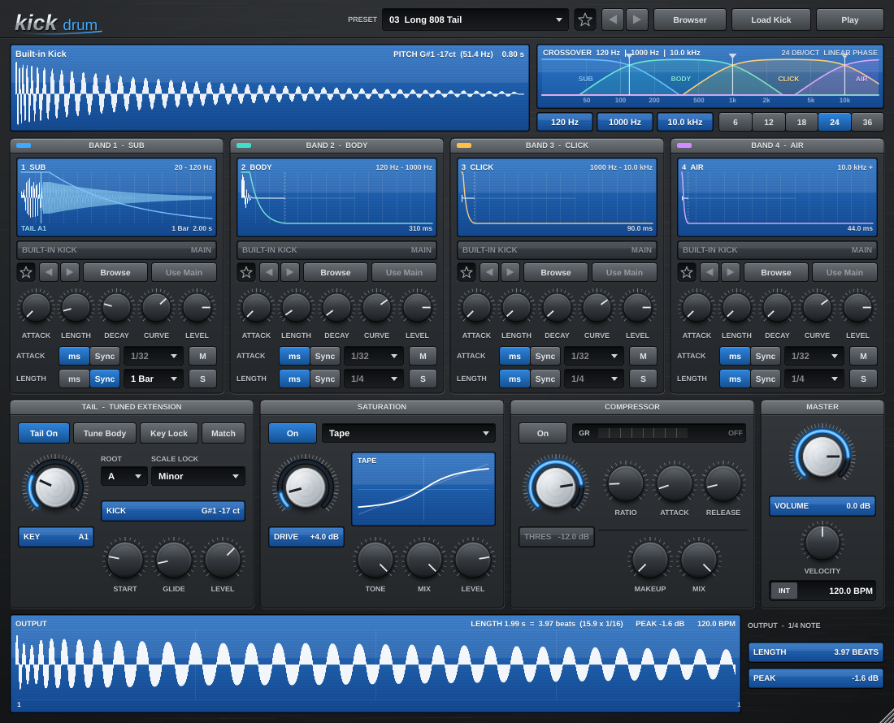

# KickDrum

A kick drum instrument (VST3, Windows x64) in the Virus Delay family look. Load a kick, and it is
split into four **linear-phase** bands, each with its own envelope, display and (optionally) its own
sample. A tuned tail extends the kick in a key, and an FX section adds saturation and a clean
compressor.



## Download

Every push to `main` builds the plugin on GitHub Actions:

* **Actions** tab > latest *Build and test* run > artifact **KickDrum-VST3-Windows-x64**, or
* the `builds-windows` branch: `KickDrum-VST3-Windows-x64.zip`.

Unzip and copy `KickDrum.vst3` to `C:\Program Files\Common Files\VST3`, then rescan in your DAW.
It appears as an instrument under **VirusDelay Project**. Any MIDI note plays the kick.

## Crossover

* Four bands: **Sub** 20-120 Hz, **Body** 120 Hz-1 kHz, **Click** 1-10 kHz, **Air** 10 kHz and up.
* Drag the three split lines in the crossover display to move them (shift = fine, double-click resets),
  or click a frequency field under the display and type it (e.g. `120`, `1.5k`, `10 kHz`, Enter to apply).
* **Slope**: 6, 12, 18, 24 or 36 dB/oct.
* The split is done with one FFT over the whole sample using real (zero-phase) gain curves, so:
  * there is no phase shift or group delay at all, so the transient isn't smeared between bands;
  * the four curves add up to exactly 1, so with all bands open you hear the original sample, bit for bit
    (to float precision). A unit test checks this for every slope.
  * Gentler slopes ring for less time; steeper slopes keep the bands more separate.
* Moving a crossover re-splits the sample in the background; the new split takes over on the next block.

## Bands

Each band has:

* **Display**: the band's waveform (faint = before the envelope, white = after it), the envelope
  line, the playhead and, on the Sub band, the tuned tail. All four use the same time scale.
  Click to hear that band alone; double-click to open its browser; drop a file on it to give it
  its own sample.
* **Attack / Length / Decay / Curve / Level**, plus **M**ute and **S**olo. **Length** is how long the
  band lasts in total; **Decay** is the fade at its end (it can't be longer than the Length), and the
  band stays at full level in between.
* **Curve** shapes the decay: right of centre is exponential (drops fast, then a long soft tail),
  centre is linear, left is a slow start (holds its level, then falls). Every setting fades
  smoothly to silence.
* **Length: ms or Sync**. In Sync, the band lasts exactly 1/16, 1/8, 1/4, 1/2 or 1 bar at the host
  tempo (or the internal tempo when there is none), and the Decay still fades it out smoothly.
* **No clicks while editing**: a playing hit glides to new Attack / Length / Decay / Curve settings
  (about 15 ms) instead of jumping; level, mute and solo changes fade over ~10 ms; and when the
  crossover moves mid-note, the new band split crossfades in over 10 ms. Every band's audio starts
  with a 0.5 ms fade-in from zero and ends at a zero crossing with a 5 ms fade-out.
* **Every knob**: double-click to type a value (`120`, `1.5 s`, `-3 dB`, `2k`, `4:1`, `Exp 40`,
  `A1` ...; Enter applies, Esc cancels). Alt-click (or Ctrl-click) resets it.
* **Mini browser**: the band's sample (MAIN = the main kick, OWN = its own), favourite star,
  previous/next (they load into this band only, with audition), **Browse** (the full browser, for
  this band only) and **Use Main** (back to the main kick).

## Output display

The bottom row shows one full-velocity hit as it leaves the instrument (all bands, the tail, the FX and the volume),
on a bar/beat grid at the current tempo. It is rendered in the background and updates as you edit,
so you don't need to play a note. **Output view** sets how much it shows (1/4, 1/2, 1 bar or 2 bars),
and it reads out how long the hit lasts (until it stays below -60 dBFS) in beats, and its peak level.
The waveform is drawn at the screen's full resolution: every device pixel is computed from the
full-rate audio, so it stays detailed when the window is enlarged. Click it to play the kick.

## Tail (tuned extension)

* The Sub band's pitch is detected when a kick loads (shown as KICK, and on the main display).
* **Tail On**: from **Start**, the Sub band hands over to a pure sine that continues the kick's own
  tone at the same phase and level (no dip, no click), then **Glide**s to the **Key**. Its length follows
  the Sub band's envelope, so set the Sub Length to Sync **1/2** or **1 Bar** to carry the tail out past
  the 1/8 note to a full bar.
* **Key** knob: locked to the notes of the **Root / Scale** you pick (Chromatic, Major, Minor, Harmonic
  Minor, Dorian, Phrygian, Mixolydian, the pentatonics, Phrygian Dominant).
* **Match Kick**: sets the Key to the kick's own pitch (snapped to the scale).
* **Tune Body**: re-pitches the whole kick so it sits in the key (nearest octave, at most 6 semitones).
* **Level**: the tail's level relative to the kick.

## FX

* **Saturation**: Soft, Tape, Tube, Hard Clip, Foldback, Fuzz, with Drive, Tone, Mix and Level.
  4x oversampled with linear-phase FIR filters. The latency is constant whether it's on or off,
  and reported to the host, so the kick stays on the grid.
* **Compressor**: clean feed-forward design (stereo-linked peak detector, 6 dB soft knee), with
  Threshold, Ratio, Attack, Release, Makeup, Mix and a gain-reduction meter.

## Browser

The same browser as ArpSampler: Places (favourite folders), Favourites, tags, search, Auto Load
(load as you arrow through the list) and **Preview** (audition each kick as you browse). Favourites,
tags and folders are stored per computer in `%APPDATA%\KickDrum\SampleLibrary.xml` and shared by
every instance. The main browser loads into all four bands; each band's browser loads into that
band only.

## Building

Requires CMake 3.22+ and Visual Studio 2022 (JUCE 9.0.4 is downloaded automatically).

```
cmake -B build -A x64
cmake --build build --config Release --target KickDrum_VST3
cmake --build build --config Release --target KickDrumTests
build\KickDrumTests_artefacts\Release\KickDrumTests.exe
```
